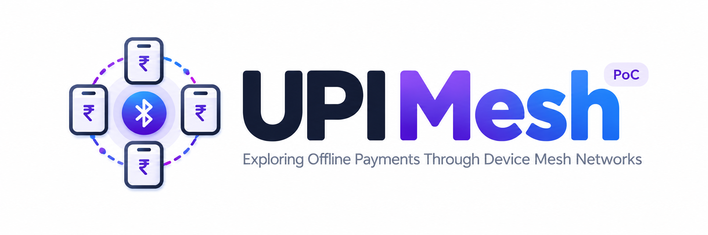
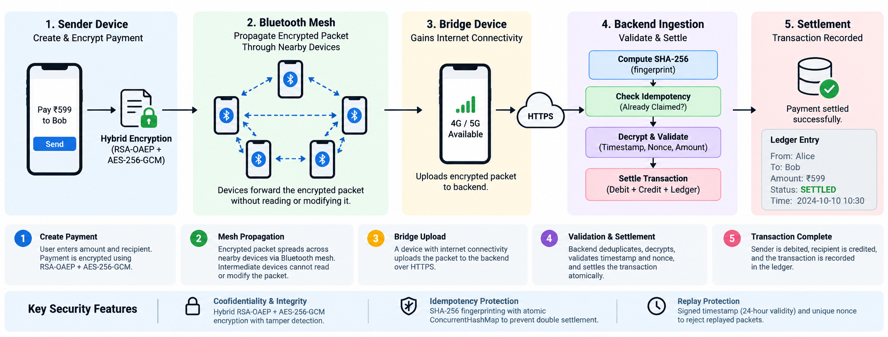
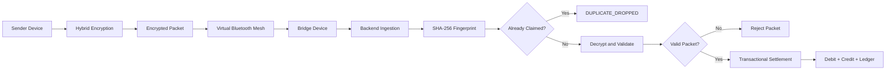
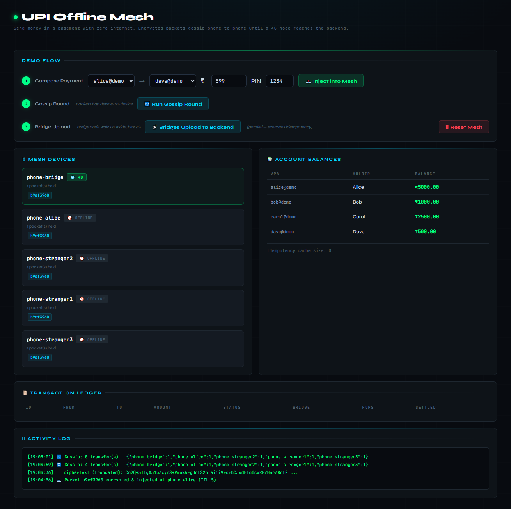
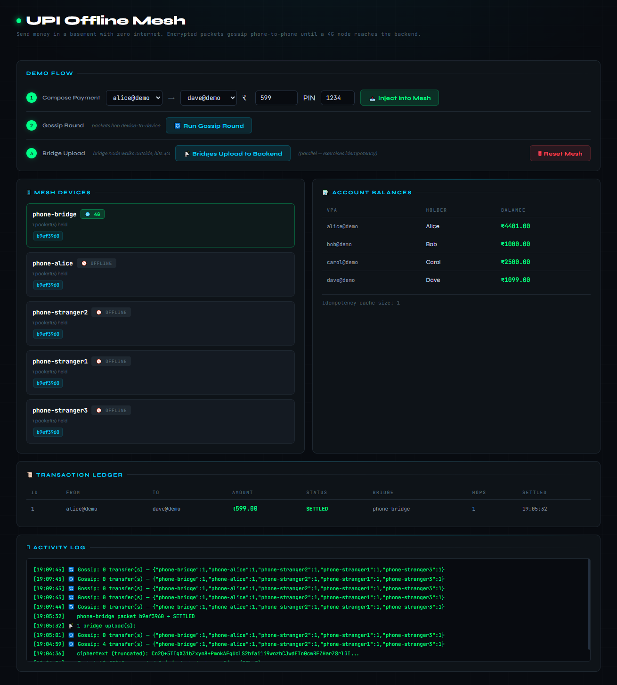

<div align="center">
  

  <p><strong>Exploring Offline Payments Through Device Mesh Networks</strong></p>

  <p>
    An experimental proof of concept for encrypted payment propagation, duplicate detection, and deferred settlement when connectivity becomes available.
  </p>

  <p>
    
    
    
    
    
  </p>

  <p>
    <a href="#demo-walkthrough"><strong>View Demo</strong></a> ·
    <a href="#architecture"><strong>Architecture</strong></a> ·
    <a href="#getting-started"><strong>Run Locally</strong></a> ·
    <a href="#api-reference"><strong>API Reference</strong></a>
  </p>

  
</div>

---

## Project Overview

UPI Mesh is a **proof of concept (PoC)** that explores how encrypted payment packets could travel between nearby devices without requiring every device to have an active internet connection.

A payment is created and encrypted, propagated across a simulated mesh of virtual devices, and uploaded to a backend when a bridge device has connectivity. The backend then validates the packet and attempts to settle the transaction.

The project demonstrates key engineering concepts involved in this workflow:

- Hybrid encryption and tamper detection
- Peer-to-peer message propagation through a simulated mesh
- Atomic duplicate detection
- Replay-window validation
- Concurrent transaction processing
- Transactional account settlement

**Scope:** The current implementation simulates mesh devices and payment settlement. It does not implement actual Bluetooth communication or integrate with the production UPI network. It must not be used to make real payments.

## Motivation

Digital payments depend on reliable connectivity between devices and payment infrastructure. In remote locations, crowded venues, or network outages, that dependency can become a problem.

UPI Mesh explores a different architecture: allow an encrypted payment packet to move through nearby devices and defer backend processing until connectivity becomes available.

This introduces several important engineering questions:

1. How can intermediate devices carry payments without reading or modifying their contents?
2. How can a backend reject duplicate packets delivered concurrently?
3. How can previously captured packets be prevented from being accepted again?
4. How can the sender's debit, recipient's credit, and transaction ledger remain consistent?

UPI Mesh implements a small, locally runnable simulation to explore these challenges.

## Features

| Feature | Description |
|---|---|
| **Hybrid encryption** | Uses RSA-OAEP and AES-256-GCM to encrypt payment payloads and authenticate their contents. |
| **Simulated device mesh** | Propagates encrypted packets across five virtual devices through gossip rounds. |
| **Deferred backend processing** | Bridge devices upload queued packets when the simulated connectivity workflow is triggered. |
| **Atomic idempotency** | Uses SHA-256 fingerprints and `ConcurrentHashMap.putIfAbsent()` to claim incoming packets atomically within a JVM. |
| **Replay-window validation** | Checks the encrypted payload's `signedAt` timestamp against a 24-hour validity window. |
| **Transactional settlement** | Performs sender debit, recipient credit, and ledger updates through a transactional service. |
| **Concurrency testing** | Tests simultaneous delivery of the same payment packet. |
| **Optimistic locking** | Uses JPA `@Version` to help detect conflicting account updates. |
| **Interactive dashboard** | Displays virtual device states, mesh propagation, bridge uploads, and transaction results. |

## Architecture

The application separates payment creation, offline propagation, bridge upload, backend validation, and settlement.



### Payment lifecycle

1. **Create:** The sender initiates a payment, and the application encrypts its payload.
2. **Propagate:** Virtual devices exchange the encrypted packet during simulated gossip rounds.
3. **Bridge:** A bridge device submits its queued packet to the backend.
4. **Deduplicate:** The backend computes a SHA-256 fingerprint and atomically claims it.
5. **Validate:** The backend decrypts the payload and validates its contents and timestamp.
6. **Settle:** A valid payment updates the sender's balance, the recipient's balance, and the ledger.
7. **Reject duplicates:** Repeated deliveries of the same ciphertext are rejected instead of being settled again.

## Security Design

### 1. Confidentiality and integrity

**Challenge:** Intermediate devices transport payment packets. How can the application prevent them from reading or silently modifying payment data?

**Approach: RSA-OAEP + AES-256-GCM**

- AES-256-GCM encrypts the payment payload and authenticates the encrypted data.
- RSA-OAEP protects the AES encryption key.
- Intermediate devices forward ciphertext without needing access to plaintext.
- Tampering with authenticated ciphertext or its authentication tag causes authentication to fail during decryption.

The RSA private key must remain protected and accessible only to the authorized decryption component.

### 2. Duplicate delivery

**Challenge:** The same packet can reach the backend from several devices at nearly the same time.

**Approach: Atomic idempotency**

The ingestion pipeline computes a SHA-256 fingerprint of the ciphertext and claims it using `ConcurrentHashMap.putIfAbsent()`.

- The first successful claim proceeds.
- Competing requests for the same fingerprint are rejected as `DUPLICATE_DROPPED`.
- Duplicate requests are stopped before database settlement begins.

This provides atomic duplicate claiming within a single JVM. It does not provide durable or distributed idempotency across multiple server instances.

### 3. Replay protection

**Challenge:** An attacker captures a packet and submits it again later.

**Approach: Timestamp validation and ciphertext deduplication**

- The encrypted payload includes a `signedAt` timestamp.
- Packets outside the configured 24-hour validity window are rejected.
- A unique nonce helps distinguish independently created payments.
- Replaying identical ciphertext produces the same fingerprint and can be rejected by the idempotency cache.

**Important:** The timestamp is protected by authenticated encryption, not by a separate digital signature. Replay protection depends on correct timestamp validation, clock handling, and appropriate retention of idempotency records.

### 4. Transaction consistency

The settlement service uses a database transaction to group the sender debit, recipient credit, and ledger write.

JPA optimistic locking with `@Version` helps detect conflicting updates to account records. A production implementation would additionally need durable idempotency, explicit failure recovery, and carefully coordinated concurrency controls.

## Demo Walkthrough

### Step 1 - Gossip propagation

Trigger a gossip round from the dashboard.

The five virtual devices propagate the encrypted packet through the simulated mesh. The packet is not settled merely because it has reached another device.



### Step 2 - Bridge upload and settlement

Trigger the bridge upload action.

The backend processes the packet through the ingestion pipeline:

`Hash → Deduplicate → Decrypt → Validate → Settle`

For the sample payment of ₹599, a successful demo transaction should debit Alice, credit Bob, and create a ledger entry.



### Step 3 - Test concurrent delivery

Run the idempotency concurrency test:

**Windows**

```cmd
mvnw.cmd test -Dtest=IdempotencyConcurrencyTest
```

**macOS / Linux**

```bash
./mvnw test -Dtest=IdempotencyConcurrencyTest
```

Expected behavior for three concurrent deliveries of the same packet:

```text
1 SETTLED
2 DUPLICATE_DROPPED
```

The account balances should reflect only one effective settlement. The exact test output depends on the test implementation.

## Tech Stack

| Layer | Technology | Purpose |
|---|---|---|
| Language | Java 17 | Application and business logic |
| Backend | Spring Boot 3.3 | REST API and service architecture |
| Encryption | RSA-2048, AES-256-GCM | Hybrid encryption and authenticated encryption |
| Key protection | RSA-OAEP | Protects the AES encryption key |
| Fingerprinting | SHA-256 | Ciphertext deduplication |
| Concurrency | `ConcurrentHashMap`, JPA `@Version` | Atomic claims and optimistic locking |
| Database | H2 In-Memory | Demo accounts and transaction ledger |
| Frontend | HTML5, CSS3 | Interactive dashboard |
| Build tool | Maven Wrapper | Dependency management and testing |

## Getting Started

### Prerequisites

- JDK 17 or later
- Maven Wrapper included in the repository
- A modern web browser

No separate Maven installation should be required when using the included wrapper.

### Run locally

Clone the repository:

```bash
git clone https://github.com/atharv96k/distributed-upi-poc.git
cd distributed-upi-poc
```

Start the Spring Boot application.

**Windows**

```cmd
mvnw.cmd spring-boot:run
```

**macOS / Linux**

```bash
chmod +x mvnw
./mvnw spring-boot:run
```

Open the dashboard at:

**http://localhost:8080**

The first run downloads the Maven dependencies.

## API Reference

| Method | Endpoint | Description |
|---|---|---|
| `GET` | `/` | Serves the interactive dashboard. |
| `GET` | `/api/accounts` | Returns accounts and balances. |
| `GET` | `/api/transactions` | Returns the latest 20 settled transactions. |
| `GET` | `/api/mesh/state` | Returns the state of virtual mesh devices. |
| `POST` | `/api/demo/send` | Creates and injects a payment into the mesh. |
| `POST` | `/api/mesh/gossip` | Executes one gossip propagation round. |
| `POST` | `/api/mesh/flush` | Uploads queued packets through bridge devices. |
| `POST` | `/api/mesh/reset` | Resets the demo mesh and idempotency cache. |
| `POST` | `/api/bridge/ingest` | Accepts a payment packet for ingestion and processing. |

## Project Structure

```text
distributed-upi-poc/
├── server/
│   └── src/
│       └── main/
│           └── java/
│               └── ...
├── screenshots/
│   ├── diagram.png
│   ├── UPI Mesh Offline-to-Online Payment Flow.png
│   ├── AfterClickingRunGossipRound.png
│   └── AfterClickingBridgesUploadToBackend.png
├── docs/
│   └── logo.png
├── mvnw
├── mvnw.cmd
└── README.md
```

The structure above is illustrative; adjust it to match the repository's actual source directories.

## Limitations

UPI Mesh is an experimental proof of concept, not a production payment application.

- **No real UPI integration:** It does not connect to NPCI or execute real UPI transactions.
- **Simulated Bluetooth:** The mesh uses virtual devices rather than actual Bluetooth discovery and communication.
- **Single-JVM deduplication:** The current in-memory idempotency cache does not coordinate multiple server instances.
- **Key management:** Production use would require secure key storage, key rotation, device identity, and access control.
- **Offline double spending:** Encryption and duplicate detection alone do not prevent every form of double spending across disconnected devices.


**Do not use this prototype to transfer real money or handle real payment credentials.**

## Roadmap

- [ ] Implement real Bluetooth Low Energy device-to-device communication.
- [ ] Introduce durable packet queues and persistent idempotency records.
- [ ] Add distributed deduplication for multi-instance deployments.
- [ ] Implement recovery for interrupted ingestion and settlement.
- [ ] Add device identity, authentication, and key rotation.
- [ ] Expand tests for replay, tampering, concurrency, and network failures.
- [ ] Investigate offline authorization and double-spending prevention.
- [ ] Explore integration with compliant payment infrastructure in a controlled environment.

## Contributing

Bug reports, issues, and pull requests are welcome.

For significant changes, open an issue first to discuss the proposed design. Do not commit private keys, credentials, or other secrets.

